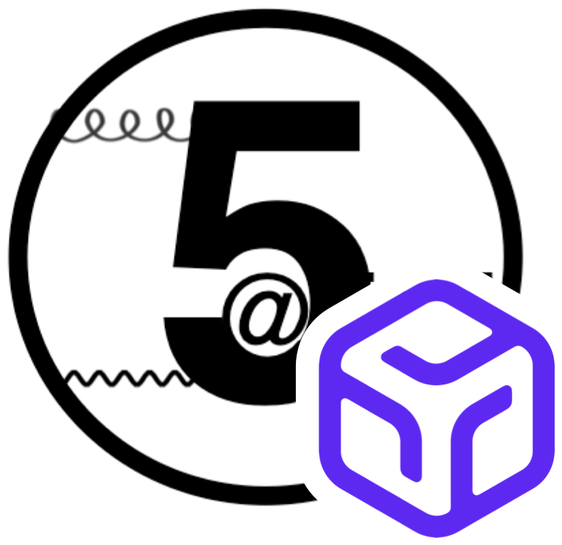

<h1 align="center">
  <br>
  MadGraph Serverless
</h1>

<p align="center">
  <a href="https://console.runpod.io/serverless"></a>
  <a href="https://hub.docker.com/r/startown/madgraph-serverless"></a>
  <a href="https://hub.docker.com/r/startown/madgraph-serverless/tags"></a>
  <a href="LICENSE"></a>
</p>

[MadGraph5_aMC@NLO](https://github.com/mg5amcnlo/mg5amcnlo) with [Pythia](https://pythia.org) and [Delphes](https://github.com/delphes/delphes) on Runpod Serverless, one HTTP request per run.

It adds a Runpod handler to [`startown/madgraph:3.8.1-7`](https://github.com/startown-ai/madgraph), which bundles Pythia, Delphes, LHAPDF, FastJet, eMELA, and ROOT.

## Installation

In the Runpod console, go to [Serverless](https://console.runpod.io/serverless), click [New endpoint](https://console.runpod.io/serverless/new-endpoint), and choose **Deploy from a Docker image** with these settings:

| Setting           | Value                                 |
| ----------------- | ------------------------------------- |
| Container image   | `startown/madgraph-serverless:0.1.0`  |
| Container disk    | 100 GB                                |
| Worker type       | CPU, 5 GHz Compute Optimized, 32 vCPU |
| FlashBoot         | on                                    |
| Execution timeout | off                                   |

Add these environment variables, so the worker can upload its results to S3-compatible storage such as Cloudflare R2:

| Variable            | Value                                                          |
| ------------------- | -------------------------------------------------------------- |
| `ENDPOINT`          | storage endpoint URL                                           |
| `ACCESS_KEY_ID`     | access key ID                                                  |
| `SECRET_ACCESS_KEY` | secret access key                                              |
| `BUCKET`            | bucket name, optionally with a folder, e.g. `my-bucket/runpod` |

A worker missing any of them stops at startup, before it takes a job.

Once the endpoint shows **Ready**, it takes runs. Each run fully occupies a worker, so under **Manage > Edit endpoint**, scale by **Request count** with 1 request per worker.

## Usage

Submit a run:

```bash
curl -X POST "https://api.runpod.ai/v2/{endpoint_id}/run" \
  -H "Authorization: Bearer {api_key}" \
  -H "Content-Type: application/json" \
  -d @request.json
```

The request holds the commands you'd enter in MadGraph. For example, this `request.json` generates 1,000 top-quark pairs with parton shower and detector simulation. The fixed core count and random seed make it reproducible:

```json
{
  "input": {
    "commands": [
      "set nb_core 32",
      "generate p p > t t~",
      "output pp2tt",
      "launch",
      "shower=Pythia8",
      "detector=Delphes",
      "done",
      "set nevents 1000",
      "set iseed 1",
      "set HEPMCoutput:file hepmc.gz",
      "done"
    ]
  }
}
```

Each request runs on its own worker. To run several in parallel, give each its own seed and output name, such as `pp2tt-s2` with seed 2. Requests with the same seed give identical events, and requests with the same output name overwrite each other's results.

Runpod removes a job 24 hours after it is submitted, even while it is still running. For longer runs, add `"policy": {"ttl": <milliseconds>}` next to `"input"`, up to 7 days.

Check a run with the job `id` that `/run` returns:

```bash
curl "https://api.runpod.ai/v2/{endpoint_id}/status/{job_id}" \
  -H "Authorization: Bearer {api_key}"
```

Once it shows `COMPLETED`, its `output` holds `{"output_path": "{BUCKET}/{name}.tar"}`, where `{name}` is the `output` name. The tar holds the whole output directory, and the results are in `{name}/Events/run_01/`:

| File                            | Contents                           |
| ------------------------------- | ---------------------------------- |
| `run_01_tag_1_banner.txt`       | every card and setting of the run  |
| `unweighted_events.lhe.gz`      | parton-level events                |
| `tag_1_pythia8_events.hepmc.gz` | particle-level events from Pythia  |
| `tag_1_delphes_events.root`     | detector-level events from Delphes |

This image defaults to `HEPMCoutput:file autoremove`, unlike MadGraph's `hepmc.gz`. In MadGraph, this setting deletes the HepMC file at the end of the run; with [`startown/madgraph`](https://github.com/startown-ai/madgraph)'s patches, it runs Delphes inside each Pythia job instead, so no HepMC is written.

You can also submit and follow runs on the endpoint's **Requests** tab in the console.

## License

This repository is licensed under the [Apache License 2.0](LICENSE). The packages it builds on keep their own licenses: see [`startown/madgraph`](https://github.com/startown-ai/madgraph#license) for MadGraph and the tools it bundles.
